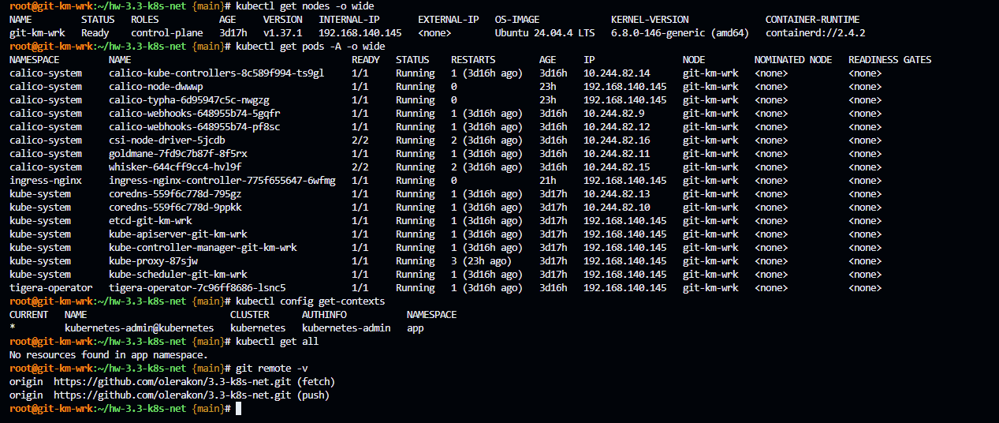
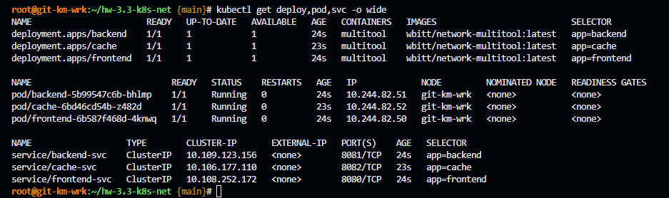
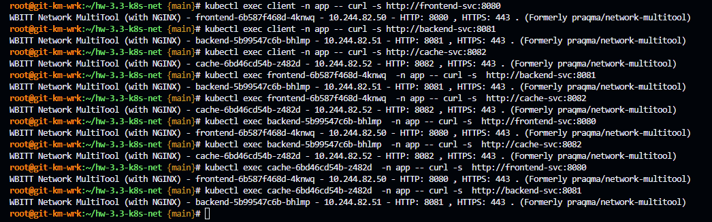
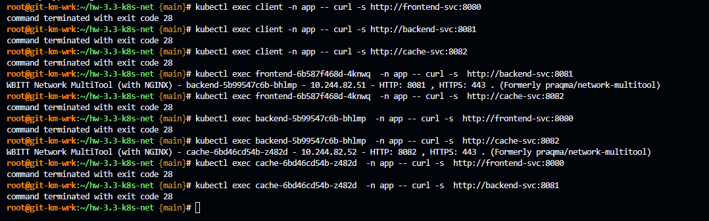

# Домашнее задание к занятию «Как работает сеть в K8s» - `Гилельс Кирилл`

## Предварительная информация

На VM Ubuntu 24.04 LTS был развернут полноценный kubernetes версии 1.37.1 в формате all-in-one-single-node средствами kubeadm.

IP адресс машины 192.168.140.145

В качестве сетевого плагина был выбран calico. Network cidr: 10.244.0.0/16

Так же был инициализирован гит [репозиторий](https://github.com/olerakon/3.3-k8s-net) проекта 

Для домашнего задания был создан отдельный ns: `app` и настроена дефолтная работа в нем через kubectl.

Сводная информация представлена на скриншоте:



------

### Задание 1. Создать сетевую политику или несколько политик для обеспечения доступа

1. Создать deployment'ы приложений frontend, backend и cache и соответсвующие сервисы.
2. В качестве образа использовать network-multitool.
3. Разместить поды в namespace App.
4. Создать политики, чтобы обеспечить доступ frontend -> backend -> cache. Другие виды подключений должны быть запрещены.
5. Продемонстрировать, что трафик разрешён и запрещён.

### Правила приёма работы

1. Домашняя работа оформляется в своём Git-репозитории в файле README.md. Выполненное домашнее задание пришлите ссылкой на .md-файл в вашем репозитории.
2. Файл README.md должен содержать скриншоты вывода необходимых команд, а также скриншоты результатов.
3. Репозиторий должен содержать тексты манифестов или ссылки на них в файле README.md.

------

### Решение

Все три приложения используют wbitt/network-multitool. Каждому из них задается свой порт, это будет удобнее при проверке к какому приложению доходит обращение.

1. frontend — 8080

2. backend  — 8081

3. cache    — 8082

Для каждого приложения создан свой деплоймент и сервис: [frontend](./manifests/frontend.yaml), [backend](./manifests/backend.yaml) и [cache](./manifests/cache.yaml).



До применения политик весь трафик между Pod разрешён. Для проверки перед внедрением политик создается тестовый под и проверяем доступность с каждого приложения на другие
```bash
kubectl run client --image=wbitt/network-multitool:latest -n app --restart=Never
kubectl exec client -n app -- curl -s http://frontend-svc:8080
kubectl exec client -n app -- curl -s http://backend-svc:8081 
kubectl exec client -n app -- curl -s http://cache-svc:8082
kubectl exec frontend-6b587f468d-4knwq  -n app -- curl -s  http://backend-svc:8081
kubectl exec frontend-6b587f468d-4knwq  -n app -- curl -s  http://cache-svc:8082
kubectl exec backend-5b99547c6b-bhlmp  -n app -- curl -s  http://frontend-svc:8080
kubectl exec backend-5b99547c6b-bhlmp  -n app -- curl -s  http://cache-svc:8082
kubectl exec cache-6bd46cd54b-z482d  -n app -- curl -s  http://frontend-svc:8080
kubectl exec cache-6bd46cd54b-z482d  -n app -- curl -s  http://backend-svc:8081
```



Наглядно видно что все соединения разрешены.

Создал [NetworkPolicy](./manifests/network-policy.yaml)

Логика политики:

frontend может обращаться только к backend;

backend может обращаться только к cache;

cache не инициирует соединения к другим приложениям;

client не имеет доступа ни к frontend, ни к backend, ни к cache;

Приложениям рарешены DNS;

входящий трафик в каждый Service разрешён только от разрешённого компонента.

NetworkPolicy в Kubernetes по умолчанию запрещает весь ingress к выбранному Pod, если хотя бы одна политика его выбирает и не разрешает соединение.

Выполняем те же проверки что и ранее:



Как можно заметить, curl в запрещенных соединениях возвращает 28 код, что эквивалентно Connection TimedOut - соединение запрещено.


frontend-to-backend разрешает ingress к Pod с меткой app: backend только от Pod с меткой app: frontend на TCP-порту 8081.

backend-to-cache разрешает ingress к Pod с меткой app: cache только от Pod с меткой app: backend на TCP-порту 8082.

frontend-ingress с пустым ingress: [] полностью запрещает входящий трафик к frontend. Это означает, что client не может обратиться к frontend.

frontend-egress и backend-egress ограничивают исходящие соединения: frontend может идти только в backend, backend — только в cache. DNS разрешён отдельно, чтобы Service-имена продолжали резолвиться.

Поскольку client не имеет метки app: frontend или app: backend, он не проходит ни под одно разрешающее правило и не может достучаться до приложений.

Итоговая схема frontend -> backend -> cache + DENY ALL, что соответствует поставленной задаче.
